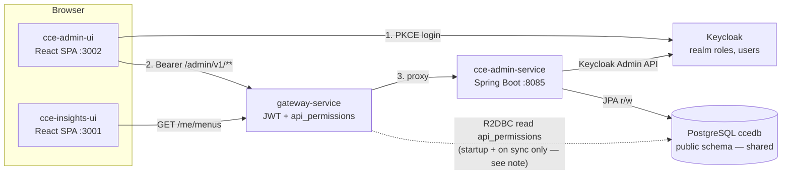
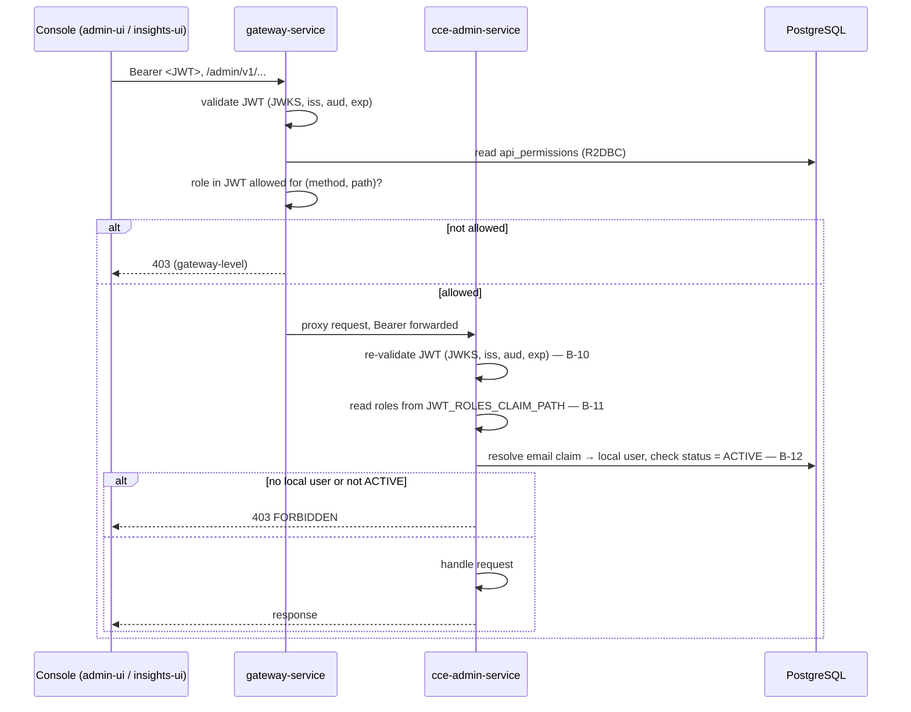
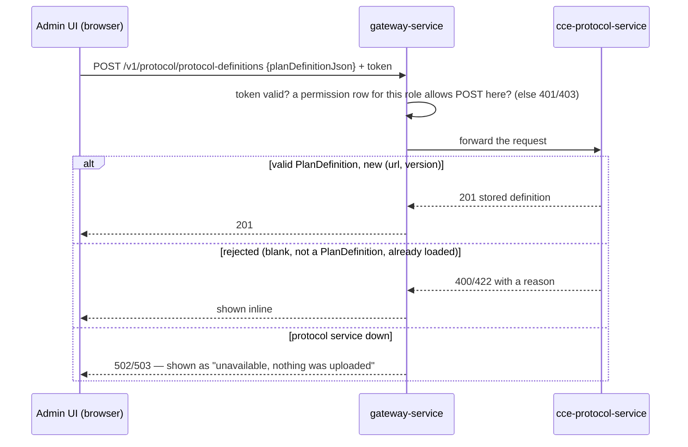

# Architecture & Design — Admin Service

> The access-control plane: who can sign in, what they can see, and what they can call — before any
> of that is checked on the hot path.

System-wide context — why the services are split, how they coordinate — lives in the
**cce-common-util** repository's
[Architecture Overview](../../cce-common-util/docs/architecture-overview.md). This document covers
only what is specific to this service. It is derived from `CCE_Admin_Module_PRD.pdf` (29 Oct 2026);
where this document and the PRD disagree, the PRD is the source of truth for contracts and behaviour
— raise it with the team rather than picking one silently.

**Status: design stage.** No code exists yet. This document, the data dictionary and the API
reference describe the service to be built, not one already running.

---

## 1. Responsibility

`cce-admin-service` owns four things:

1. **Users** — the set of people who can sign in to a CCE console, mirrored 1:1 with a Keycloak
   account.
2. **Roles** — named bundles of access (`FACILITY_ADMIN`, `SUPER_ADMIN`, …), immutable by name once
   created.
3. **Menus** — the catalog of screens `cce-insights-ui` (and any future console) can show, and which
   roles may see which ones.
4. **API permissions** — the `(HTTP method, URI pattern)` rules `gateway-service` enforces per role.

It does not enforce access itself. `gateway-service` already validates JWTs and checks
`api_permissions` on every proxied call; this service is what lets an administrator *configure* that
table and the Keycloak accounts behind it through a UI, instead of hand-editing SQL and the Keycloak
console.

```
Platform administrator ──REST (cce-admin-ui)──> Admin Service ──> users / roles / menus / role_menus
                                                             ──> api_permissions
                                                             ──> Keycloak (accounts, realm roles)
                                                             ──> admin_audit_log
```

## 2. Why two independent axes

A role's relationship to menus and to permissions are deliberately **not derived from each other**:

- **Role → Menu** is a soft control. It decides what `cce-insights-ui` renders in the sidebar. Get it
  wrong and a user sees a link to a screen whose API calls still fail — cosmetic, not a security
  issue.
- **Role → Permission** is a hard control. It decides what `gateway-service` will actually proxy.
  Get it wrong and a user either can't do their job, or can reach an API nobody intended them to.

Auto-deriving one from the other (e.g. "granting the Compliance menu implies the Compliance APIs")
would collapse a cosmetic mistake and a security mistake into the same edit, which is exactly what
this design avoids. Both are configured on the same Role Detail screen in `cce-admin-ui` so neither
is forgotten, but saving one never writes the other.

## 3. One identifier, three systems

A role's `roles.name` is used **unchanged** in two other places: as the Keycloak realm role name,
and as `api_permissions.permission_name`. That is a single string doing three jobs, which is why:

- `roles.name` is immutable after creation — renaming it would silently orphan the Keycloak role and
  the permission rows that reference the old name.
- the create-role form must warn before submit, since there's no way to undo a bad name except
  deleting the role (blocked if it's in use) and starting over.

| Responsibility | Owner |
|---|---|
| Create/delete realm role **definitions** in Keycloak | `gateway-service`, via its existing `POST /api/permissions/sync-to-keycloak`, sourced from `api_permissions` |
| Create the Keycloak **user** account | `cce-admin-service` (Keycloak Admin REST API) |
| Assign/remove realm roles **on a user** | `cce-admin-service` |
| Password reset / required actions | `cce-admin-service` |

`cce-admin-service` never creates or deletes a realm role definition directly — it writes
`api_permissions` rows and calls gateway-service's sync endpoint, which is already the authoritative
writer of realm role definitions. Duplicating that in two places would let them drift.

## 4. System context



Both consoles are peer Keycloak-authenticated SPAs behind the same `gateway-service`. Neither talks
to the database or to Keycloak's admin API directly. The gateway validates the JWT, checks the
caller's role against `api_permissions`, and proxies `/admin/v1/**` to this service — which
**re-validates the JWT itself** (defense in depth) and rejects tokens whose local user is missing or
not `ACTIVE`.

**Corrected after reading `gateway-service`'s actual code, not just inferring from the table name:**
`gateway-service` does **not** query `api_permissions` on every request. `AuthorizationService`
checks an **in-memory cache** (`PermissionConfig`), populated once at startup
(`ApplicationReadyEvent`). The database is only read again when `POST
/api/permissions/sync-to-keycloak` runs — that call's first step reloads the *entire* cache from the
table before its second step pushes role definitions to Keycloak. This service's `PUT
/roles/:id/permissions` already calls that sync endpoint after every write, so the cache is always
refreshed at the right moment in practice — the diagram above describes the real mechanism, not just
"it happens to work."

**Fixed constraint — confirmed against the real dev instance, not just documented.**
`gateway-service` already reads a table named `api_permissions` via R2DBC, and that table lives in
**`ccedb`'s `public` schema** — the same database and schema every other CCE service already shares
(`protocol_definition`, `deviation`, `facility`, `matcher_event_log`, …). It is **not** a separate
`admin_service` database, despite that being what the PRD's diagram and `gateway-service`'s own
`DATABASE_PERMISSIONS_MIGRATION.md` describe — those describe gateway-service's bundled
default/local-dev convenience config, not the real UAT/prod topology (confirmed via the kustomize
overlays, which set `POSTGRES_DB=ccedb` for every service including `gateway-service`, and verified
directly against a live dev `ccedb` instance where `api_permissions` sits alongside every other
service's tables). See §9.1.

## 5. Request lifecycle (authenticated endpoints)



`cce-admin-service` re-validating the JWT is deliberate redundancy, not a mistake to simplify away: a
caller who reaches this service by some path other than the gateway (misconfiguration, direct network
access) must still be rejected. See §10 for the network assumption this still depends on.

## 6. Package layout

```
controller/   HTTP shape only — request/response DTOs, status codes, no business logic
service/      Business logic, transaction boundaries
repository/   Spring Data JPA
entity/       JPA entities
security/     JWT re-validation, role/claim resolution, current-user resolution
client/       Keycloak Admin REST client, gateway sync client — side effects live here
audit/        admin_audit_log writes — the only place that inserts into admin_audit_log
config/       Spring configuration
```

Controllers only shape HTTP; every call to Keycloak or to the gateway sync endpoint goes through
`client/`, so those can be mocked in service-layer tests without a running Keycloak
([Milestone B3 note](#8-testability), PRD §10). `audit/` is likewise the only writer of `admin_audit_log` —
no service class inserts an audit row directly — so "did this mutation get audited" is a single-place
review rather than a per-endpoint one.

## 7. Consistency model

Keycloak calls can partially fail — a user can be created in Keycloak and then fail to persist
locally; a permission set can be written locally and then fail to sync to the gateway. This service
does not retry automatically. Two different strategies are used, deliberately per-flow rather than
one universal rule — see [flow-diagrams.md](flow-diagrams.md) for the exact sequencing of each
mutation:

- **Role → permission sync (Flow 4):** the local DB write commits first and is **kept** regardless of
  whether the subsequent gateway sync succeeds — a sync failure never rolls back an already-committed
  local change. This is safe specifically because nothing here ever tries to interpret an ambiguous
  external-call outcome; it just leaves the local state as the source of truth and offers a manual
  **Re-sync** action.
- **User creation (Flow 2):** the opposite — local-first **with rollback**. The local insert happens
  inside an open transaction; Keycloak calls follow; if either Keycloak call fails, or if the final
  commit itself fails after both Keycloak calls already succeeded, the local transaction rolls back
  and nothing persists. This trades a small amount of residual risk for simpler rollback semantics:
  if a Keycloak call's failure is **ambiguous** (a network timeout, not a definitive rejection), it's
  possible Keycloak actually succeeded despite us never receiving confirmation — in that specific,
  rare case, the rollback also erases the only local evidence the attempt happened, producing a
  silent, untraceable orphan. This is an accepted trade-off, not an oversight.
- **Keycloak account confirmed, something fails after (role assignment, or the final commit):** in
  this case Keycloak's success is **not** ambiguous — it's confirmed — so this one is always traceable.
  A reconciliation row (`USER_PROVISIONING_FAILED`) is written in its own, separately-committed
  transaction *before* the main transaction is rolled back, with `entity_id` set to the Keycloak
  account's own id. There is no UI for reconciliation in this release — an operator reads
  `admin_audit_log` directly.
- **User edits, status changes and role changes (Milestone 6)** use the same local-first shape as creation, plus
  a **reversal** step: each Keycloak change is paired with the call that undoes it (`KeycloakChangeSet`).
  A failing call reverses the ones already applied, then the local transaction rolls back; a failing
  *commit* reverses Keycloak too. Only if a reversal itself fails is a `USER_SYNC_FAILED` row written
  (own transaction) because Keycloak and the database may now disagree.
- A role's realm role must exist in Keycloak (i.e. a successful sync) **before** it can be assigned
  to any user — not because `gateway-service`'s enforcement would otherwise be stale (its permission
  cache reloads as an unconditional first step of the sync call, even if the sync's second step then
  fails to reach Keycloak), but because Keycloak itself would reject assigning a realm role that
  doesn't exist yet. Same rule, for the actual reason — see
  [flow-diagrams.md Flow 4](flow-diagrams.md#flow-4--permission-replacement--sync).

This is a correctness requirement, not an operational nicety — the PRD frames this as a compliance
platform, so "who gave this user access, and when" must be answerable from `admin_audit_log` even when a
Keycloak call fails partway through.

## 8. Testability

Backend: service-layer tests with the Keycloak Admin client and the gateway sync client mocked behind
the `client/` interfaces (§6) — no integration test depends on a running Keycloak. Frontend: MSW-mocked
API, forms tested through user input and submit, no network in unit tests.

## 9. Open architectural decisions

These are gaps in the PRD that affect this document and the data dictionary directly. They are
flagged here rather than silently resolved one way, per the PRD's own golden rule (§1 of the PRD).

### 9.1 Schema target and `api_permissions.id` type — resolved

Two decisions, confirmed together:

**Database/schema target: `ccedb`, `public` schema — not a separate `admin_service` database.**
Verified directly against a live dev `ccedb` instance: `api_permissions` already sits there, in
`public`, alongside `protocol_definition`, `deviation`, `facility`, `matcher_event_log`, and every
other service's tables — each with its own `flyway_schema_history_<service>` ledger (e.g.
`flyway_schema_history_protocol`, `_compliance`, `_scheduler`). This service's six new tables
(`users`, `roles`, `menus`, `role_menus`, `user_roles`, `admin_audit_log`) follow the same convention: they
go into `ccedb`'s `public` schema, with their own `flyway_schema_history_admin` ledger — **not** a
new database, and not a dedicated schema either, since no other service in this platform namespaces
its tables that way.

**`api_permissions.id` stays `BIGSERIAL`/`Long`.** `gateway-service`'s existing entity
(`gateway-service/src/main/java/.../model/ApiPermission.java`) declares `@Id private Long id` against
a `BIGSERIAL` column, and it already owns the R2DBC read path for this table in the real, shared
`ccedb.public.api_permissions`. The PRD's requirement B-01 describes UUID PKs across all seven
tables; this service's migration follows that for the six tables it owns, and leaves
`api_permissions`'s existing `BIGSERIAL` `id` untouched — it is the one odd one out among the seven,
called out explicitly rather than hidden. This service's migration does **not** `CREATE TABLE
api_permissions` at all — the table already exists with real rows. Any DDL this service ever needs
against that table (e.g. adding a column) must be written as an `ALTER TABLE ... IF NOT EXISTS` against
the existing table, the same way `gateway-service`'s own seed script treats it
(`CREATE TABLE IF NOT EXISTS public.api_permissions`), and should be coordinated with whoever owns
`gateway-service` first — it is a live table a second service is now also writing to.

### 9.2 Role claim path — confirm before Keycloak provisioning

`gateway-service`'s own default (`application.yml`) reads roles from `realm_access.roles` (a realm
role), matching the PRD's `JWT_ROLES_CLAIM_PATH` default and its whole "Role = realm role" model. The
CCE Rwanda production handover, however, documents gateway authorization as reading
`resource_access.gateway-service.roles` (a *client* role) in that deployment. Both are possible via
the `JWT_ROLES_CLAIM_PATH` env override — but it changes whether this service should be assigning
**realm** roles or a **client** role on `gateway-service` when it provisions a user in Keycloak.
Confirm the actual configured claim path for the realm this service will run against before writing
the Keycloak client in `client/` (B-11, B-20).

### 9.3 Role taxonomy coexistence — needs a migration plan

The platform already has flat, single-purpose realm roles granted directly in Keycloak today
(`INSIGHTS_READ`, `REPORT_READ`, `COLLECTOR_EVENTS_WRITE`, …). This service introduces a second,
coarser model — personas (`FACILITY_ADMIN`, …) that bundle menus and permissions. The PRD does not
say whether personas replace today's direct grants or sit alongside them. If a user today has only
`INSIGHTS_READ` granted by hand, and no persona's permission set is backfilled to cover the same API
pattern after this service goes live, that user loses dashboard access on cutover with no error
visible until they next try to use it. Worth a short migration note before go-live: enumerate today's
directly-granted roles, and decide which persona (if any) absorbs each one.

### 9.4 Bootstrap sequencing — no concrete owner yet

Two bootstrap problems are listed as risks in the PRD (§12) without an owner:

- **First `SUPER_ADMIN`.** Must exist in Keycloak *and* locally, with `api_permissions` rows covering
  `/admin/v1/**`, before anyone can use `cce-admin-ui` at all. This can't be created through the UI
  it gates — it has to be seeded (Flyway `V2__seed.sql`, per milestone B1/B2) or provisioned by a
  one-off script per environment.
- **Every console user's `GET /admin/v1/me/menus` permission row.** Without a permission row for that
  exact endpoint, no role can load a sidebar in any console, including `cce-insights-ui`'s future
  integration. This should be seeded alongside the `SUPER_ADMIN` bootstrap, not left to be discovered
  per environment.

**Resolved (Milestone 2):** both are handled by a split, matching `cce-insights-service`'s
`onboard-insights-user.sh` pattern.

- **Migration-seeded (`V2__seed.sql`)** — the `SUPER_ADMIN` role, the 7 menus, the `role_menus` links,
  and the `api_permissions` rows (including the exact `GET /admin/v1/me` and `GET /admin/v1/me/menus`
  rows). Reference data, identical in every environment, no personal data.
- **Per-environment script (`scripts/bootstrap-admin.sh [email]`)** — the first `SUPER_ADMIN`
  *account*: creates the Keycloak realm role if gateway hasn't yet synced it, assigns it to an
  existing Keycloak user, enables it, and inserts the local `users` + `user_roles` rows, flagging the user
  `is_system` so the console treats it as a read-only system account (Milestone 6: otherwise any other
  admin could lock the platform's own admin out). Idempotent, so it is also the recovery tool. A named
  admin never lives in a migration.

### 9.5 Deferred for a future release

Noted so they aren't re-litigated per the PRD's explicit scope cut (§2 "Out of scope"), and because
they came up during this review:

- **Audit log viewer.** `admin_audit_log` is written but has no read endpoint or screen this release.
  "Who gave this user access, and when" is answerable only via direct SQL until one exists.
- **Read-only "Auditor" persona.** Right now the only two admin-service personas are `SUPER_ADMIN`
  (full write) and console users (no admin-service access at all) — nothing lets someone review "who
  has access to what" without being able to change it. Pairs naturally with the audit log viewer
  above; deliberately **not** added to this release's scope.
- **Facility-scoped enforcement.** `users.facility_scope` is stored and displayed only; nothing
  enforces it yet.

### 9.6 Authorization is enforced at the gateway, not in this service

> **Superseded by Milestone 7 (planned)** — the service will enforce roles itself; see [§9.9](#99-planned-milestones-78--role-aware-console-and-protocol-management). Until then, what follows is the current behaviour.

Every `/admin/v1/**` endpoint in this service requires a valid JWT and a local `ACTIVE` user — nothing
more. *Which role may call which endpoint* is enforced by `gateway-service` against `api_permissions`
(the `SUPER_ADMIN` rows seeded by `V2__seed.sql`), by design (§3). Consequences to know about:

- Locally, `cce-admin-ui`'s Vite proxy talks to this service directly (`localhost:8085`), bypassing
  the gateway, so **any `ACTIVE` local user can currently create/delete roles** in that setup.
- Behind the gateway in a real environment, a caller without the `SUPER_ADMIN` realm role is stopped
  before reaching this service.
- A service-level `SUPER_ADMIN` check would be defence in depth, but it is not specified by the PRD
  and would make this service a second source of truth for permissions. Revisit in Milestone 8
  (End-to-End), which runs the whole chain through the real gateway.

### 9.7 gateway-service's sync endpoint is unauthenticated — verified, not assumed

`JwtValidationFilter` is attached only to the proxied `/admin/**` route in gateway's configuration;
`/api/permissions/**` is a controller on the gateway application itself and is **not** behind it.
Verified against a running gateway (Milestone 4): `POST /api/permissions/sync-to-keycloak` and
`GET /api/permissions/keycloak/test-connection` answer `200` with no `Authorization` header.

- **Consequence for this service:** `GatewaySyncClient` sends no token and no extra gateway
  permission rows are needed (an earlier plan to forward the caller's JWT and seed one was dropped).
- **Consequence for operations:** anything that can reach gateway's port can trigger a global
  Keycloak reconcile, including deleting realm roles. Keep `/api/permissions/**` off any public
  ingress (network policy or ingress rules) — that is the only protection today.
- Not changed here: `gateway-service` belongs to another team. Raise it with them.

### 9.8 How this service signs in to Keycloak's Admin API, and the email it triggers

Two modes, chosen by `KEYCLOAK_ADMIN_CLIENT_SECRET` (see `application.yml`):

- **Secret set → `client_credentials`** as a service-account client in the target realm (`cce`). Use this
  in every real environment, with a client that has only the `manage-users` / `view-realm` /
  `view-users` roles it needs. The client does not exist in `cce-realm.json` yet (see developer-setup.md).
- **No secret → password grant** as `KEYCLOAK_ADMIN_USERNAME` in `KEYCLOAK_ADMIN_REALM` (default
  `master`, user `admin`/`admin`). Local development only — it is the Keycloak super-admin.

HTTP timeouts are explicit (5 s connect, 20 s read): user creation holds a database transaction open
across the Keycloak calls, so a hung Keycloak must turn into a `502`, not a stuck request.

The invitation email is sent by **Keycloak**, not this service, so the realm needs working SMTP. A realm
without it fails every send; creation still succeeds with a `warnings` entry. `scripts/setup-local-mail.sh`
wires the local realm to a Mailpit container (web UI `http://localhost:8025`) for development.

> **Planned — Milestone 7:** in the `prod` Spring profile the service **refuses to start** unless
> `KEYCLOAK_ADMIN_CLIENT_SECRET` is set — the password fallback is not allowed there, so it can never
> silently run on the default `admin`/`admin`. Local development (no `prod` profile) is unchanged. Production
> prerequisite: a service-account client in the production `cce` realm with the user and role management
> rights it needs (a Keycloak admin task). The production realm already has SMTP (see §9.10).

### 9.9 Planned (Milestones 7–8) — role-aware console and protocol management

> **Planned — Milestone 7. Not implemented yet;** this is the agreed design, written first (docs-first).

**Why.** Protocol definitions are loaded today with `curl` against `cce-protocol-service`; there is no
screen and no restriction beyond the gateway. Loading or retiring one changes clinical matching, so it
must be limited to the people meant to do it, and a `SUPER_ADMIN` must be able to hand that access to
others. The PRD covers users, roles, menus and permissions only — **this is a deliberate scope addition**.

**Decisions** (agreed 2026-11-25/26; this replaces an earlier draft that proxied protocols through this
service and seeded a `PROTOCOL_MANAGER` role)

1. **This service does not proxy protocols.** The admin UI calls `cce-protocol-service`'s existing API
   (`/v1/protocol/protocol-definitions`) **through the gateway**, with the user's own token. The gateway
   route `/v1/protocol/**` and its permission rows are the only gate. `cce-protocol-service` is **not
   changed**: it keeps the platform convention of trusting the gateway (no token check, no audit table).
2. **No seeded `PROTOCOL_MANAGER` role.** `SUPER_ADMIN` gets the Protocols tab and the gateway rows from
   migrations. Any other role is made by a `SUPER_ADMIN` with the existing screens (see the checklist below).
3. **v1 = list, view, upload, retire.** Not delete, not rebuild-index, not action definitions.
4. **The admin console's tabs become menu entries.** `menus.console` distinguishes `INSIGHTS` from `ADMIN`
   entries (Users, Roles, Menus, Protocols); `cce-admin-ui` builds its sidebar from
   `GET /me/menus?console=ADMIN`. **This reverses the earlier F-03 decision** that the admin sidebar is
   static: a link a user can't use is no longer shown. Menus stay the *soft* control; permission rows and
   the checks below stay the *hard* one.
5. **Authorization in this service**, closing §9.6:

| Endpoints | Required |
|---|---|
| `/admin/v1/health`, Swagger | none |
| `/admin/v1/me`, `/admin/v1/me/menus` | any signed-in, `ACTIVE` user |
| everything else under `/admin/v1/**` (users, roles, menus, permissions) | `SUPER_ADMIN` |

   The check reads the user's **database roles** (`user_roles`), not the token's role claim. Two reasons:
   the sidebar already uses the database roles, so what a person *sees* and what they *may do* can never
   disagree for the few minutes a token takes to refresh; and it does not depend on which claim path the
   production gateway reads (open question Q3). The gateway still checks the token and its permission rows
   in front, as a second layer. Because the check is in this service, a limited user is refused even where
   the gateway is bypassed (the local setup).
6. **Tab rules.** `SUPER_ADMIN`'s four admin tabs cannot be removed (409), so nobody can lock themselves
   out. The **Users, Roles and Menus** tabs can only belong to `SUPER_ADMIN` — the server refuses them on
   any other role (409) and the UI greys them out — because every call behind them is `SUPER_ADMIN`-only.
   The **Protocols** tab and the insights tabs can be given to any role.
7. **Startup safety.** In the `prod` profile this service refuses to start unless
   `KEYCLOAK_ADMIN_CLIENT_SECRET` is set (a service-account client in realm `cce`); the `admin`/`admin`
   password fallback is allowed only outside `prod`. See §9.8.
8. **Only a `SUPER_ADMIN` grants access:** a protocol manager never sees Users or Roles.

**How a protocol upload flows** — this service is not involved:



**What makes a role able to manage protocols** — a `SUPER_ADMIN` does this once per role, with the existing
Roles screens:

1. Create the role (any name).
2. **Menus tab:** tick **Protocols**.
3. **Permissions tab:** add four rows —
   `GET /admin/v1/me`, `GET /admin/v1/me/menus` (without these the gateway blocks the sidebar from loading
   for that role in a gateway-fronted environment; the local dev server skips the gateway, so the omission
   only shows up in production) and `GET`, `POST /v1/protocol/protocol-definitions/**` (retire is a
   `POST`, so it is covered). Saving runs the gateway sync.
4. Map the role to users.

A role with the tab but not the protocol rows sees the tab and gets an inline "your role isn't allowed";
a role with the rows but not the tab is allowed but never sees the page. The two are independent, as the
PRD intends (menus = what you see, permission rows = what you may do).

**Local development.** Run `cce-protocol-service` on port **8091** (its default 8090 collides with the local
gateway); `scripts/run-gateway-local.sh` adds a gateway route for `/v1/protocol/**` to it; `cce-admin-ui`'s
dev server forwards `/v1/protocol` to the gateway (8090). After the V5 seed (SUPER_ADMIN's protocol rows) run
the gateway sync once so the gateway reloads its rules.

### 9.10 Open questions (recorded, not decided, not built in Milestones 7–8)

| # | Question | Notes |
|---|---|---|
| Q1 | **Protocol audit** — who uploaded or retired what, and where it is stored: the shared `admin_audit_log` (needs a nullable actor and a start-up-order answer), a table inside `cce-protocol-service`, or elsewhere. | Until decided, only the protocol service's application log records it. The gateway already forwards `X-User-Name` after validating the token. |
| Q2 | **Token check in the protocol service, and a network policy** so only the gateway can call it. | Today no CCE backend except the gateway and this service checks a token, and any pod in the cluster's namespace can call the protocol service directly. Platform convention for now. |
| Q3 | **Production role claim path.** The production gateway reads `resource_access.gateway-service.roles` (client roles); this console assigns *realm* roles and the gateway's sync creates realm roles. | Confirmed by the production handover and the Kubernetes config. Resolve before go-live; Milestone 10 should include a run in client-role mode. Milestone 7's database-role check does not depend on it, but the gateway layer does. |
| Q4 | **Existing production users.** People onboarded by `onboard-insights-user.sh` exist in Keycloak but not in this service's `users` table. | They would be unknown to the Users list, and creating one with the same email answers "already in use". |
| Q5 | **Kubernetes.** The deployment files have no admin-service route or ingress, and the gateway's built-in `/admin/**` route may be overwritten by the numbered route environment variables. | Checked in Milestone 11. |
| Q6 | **Can a retired protocol be un-retired?** The protocol API shows no such call. | Confirm when building the Retire button. |

*Resolved:* production email. The handover states SMTP (Office 365, sender `CCERwanda@medtroniclabs.org`) is
already configured on the `cce` realm in production and UAT, with 72-hour links — the same as this service
requests. Only the mailbox credentials need to stay valid.
