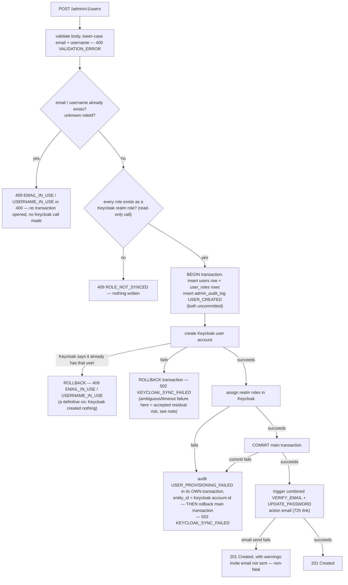
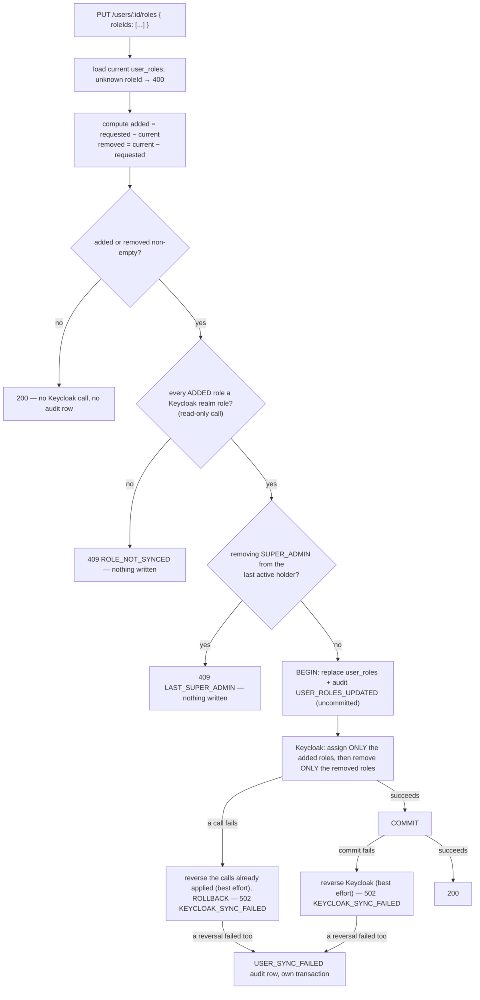
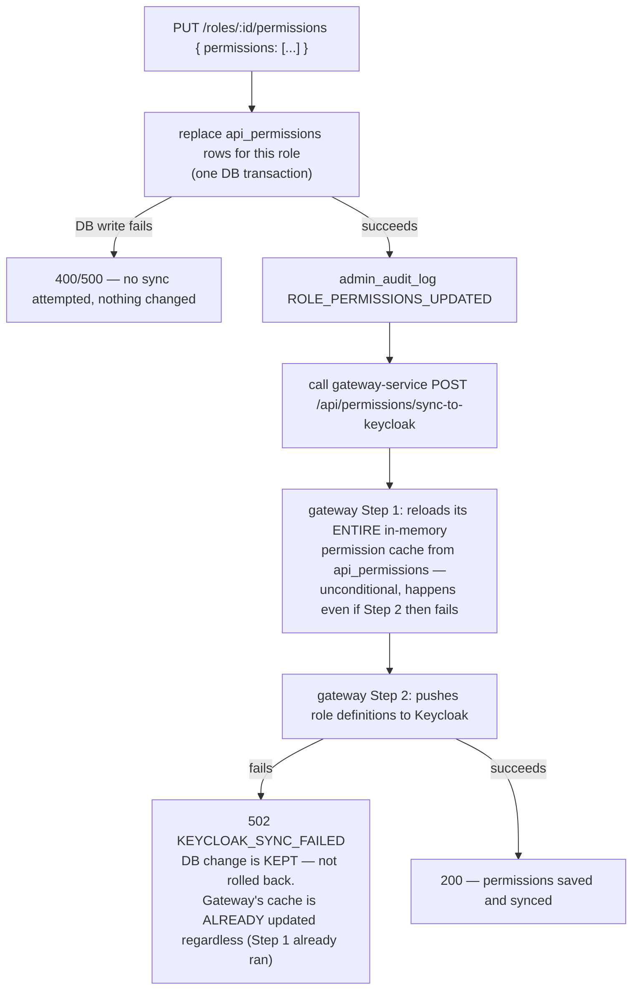
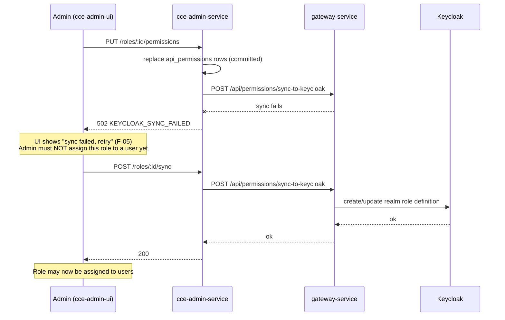
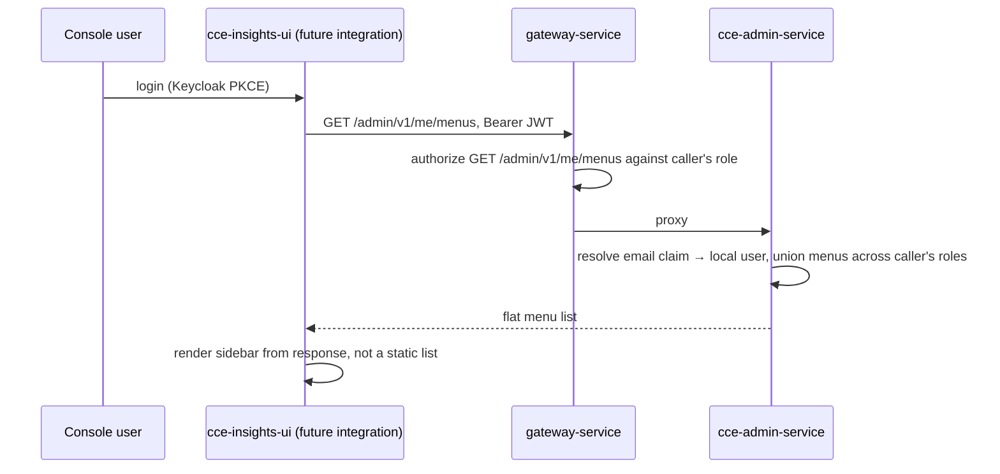

# Flow Diagrams — Admin Service

The PRD (`CCE_Admin_Module_PRD.pdf`) references "flow diagram 2" (B-31) and "flow diagram 4" (B-43,
milestone B4) as if they exist in the team's design documentation. They weren't included in the PRD
pages themselves, so this document reconstructs them from the written requirements — treat these as
a first draft to check against that source, not a replacement for it (PRD §1 golden rule).

---

## Flow 1 — Authenticated request lifecycle

See [architecture-overview.md §5](architecture-overview.md#5-request-lifecycle-authenticated-endpoints)
for the gateway → admin-service sequence diagram. Every flow below happens *after* that check passes.

---

## Flow 2 — User creation

`POST /admin/v1/users` (B-31, B-32). **Local-first, with rollback** — the local insert happens inside
an open transaction before either Keycloak call; a Keycloak failure, or a commit failure after both
Keycloak calls already succeeded, rolls the local transaction back.

Validation and the email-uniqueness check happen **before any transaction is opened or any Keycloak
call made**, so a client error never touches either system. Past that point, two distinct failure
shapes:

- **Keycloak's account-creation call fails** — if it's a definitive rejection (bad input, Keycloak-side
  duplicate), the rollback is completely safe: Keycloak created nothing, local has nothing, no
  reconciliation needed. If it's an **ambiguous** failure (a timeout — not a confirmed "no"), it's
  possible Keycloak actually processed the request anyway; rolling back in that case erases the only
  local evidence the attempt happened, producing a silent, untraceable orphan. This is an accepted
  trade-off of choosing local-first, not an oversight — see
  [architecture-overview.md §7](architecture-overview.md#7-consistency-model).
- **Role assignment fails, or the final commit fails after both Keycloak calls already succeeded** —
  in both cases Keycloak's account creation is **confirmed**, not ambiguous, so this is always
  traceable: a `USER_PROVISIONING_FAILED` row is written in its own, immediately-committed
  transaction (`entity_id` = the Keycloak account's own id, since no local row survives) *before* the
  main transaction rolls back. **This needs explicit handling in code at both failure points** — a
  commit failure doesn't automatically trigger this write; the implementation must wrap the commit
  boundary itself (not just the two Keycloak calls) and call the same reconciliation-write path from
  there too (see A9 in `cce-admin-service-subtasks.txt`).

**Why the invitation email is the very last step, not sent alongside Keycloak account creation:**
sending it earlier would mean a Keycloak-call failure or late commit failure (above) leaves a real,
working "set your password" link pointing at an account that then gets rolled back locally — the user
could complete verification and password setup, then hit `403 FORBIDDEN` on every subsequent request,
because [B-12's resolution](architecture-overview.md#5-request-lifecycle-authenticated-endpoints)
can't find a local row for them (it was rolled back). Ordering the email after the commit succeeds
guarantees nobody ever receives a working link to an account that isn't fully, durably usable yet.

**Operational note, not a correctness issue:** holding the local transaction open across two outbound
Keycloak HTTP calls means any row-level locks from the insert are held for that whole duration. Fine
at this console's expected scale (low-throughput CRUD), but worth knowing — a slow or degraded
Keycloak ties up local DB connections for longer than a design that committed locally first would.

---

## Flow 3 — Role assignment diff

`PUT /users/:id/roles` (B-35). The request carries the **full desired set**; this service computes the
delta rather than touching Keycloak role-by-role for the whole set. Like creation (Flow 2) it is
**local-first with rollback** — an earlier draft of this flow changed Keycloak first, which could leave
Keycloak changed with nothing recorded locally.

Only the changed realm roles are touched in Keycloak — a user with 5 roles who gains a 6th causes one
Keycloak role-assignment call, not six. The same shape (local change + audit → Keycloak changes, each with
its reversal → commit) is used by profile edits and by deactivate/reactivate, which additionally ends the
user's Keycloak sessions.

---

## Flow 4 — Permission replacement + sync

`PUT /admin/v1/roles/:id/permissions` (B-42, B-43, milestone B4). The DB write and the gateway sync
are **not** one atomic operation — the DB change is durable even if the sync step fails.

The DB change surviving a sync failure is deliberate (PRD §9 "Consistency" — "DB changes remain
saved"): a role's **intended** permission set is still correct in the database even if Keycloak
hasn't caught up yet. `cce-admin-ui` shows a distinct "sync failed, retry" state (F-05) and a manual
**Re-sync** action (`POST /roles/:id/sync`, Flow 5) rather than silently discarding the edit.

**Why this matters even though gateway's enforcement is already up to date.** Checked directly
against `gateway-service`'s code: its `sync-to-keycloak` endpoint reloads its own in-memory
permission cache (`PermissionConfig`) as an **unconditional first step**, before attempting the
Keycloak push — so even on a `502` here, gateway is already enforcing the new permission set. The
reason a role still can't be assigned to a user after a sync failure isn't "gateway hasn't caught up"
— it's that **the realm role itself doesn't exist in Keycloak yet** (only step 2, the part that
failed, creates it), and Keycloak will reject assigning a role it doesn't know about. Same rule
("wait for a successful sync before assigning"), more accurate reason.

---

**Sync is global, and it deletes.** gateway's sync has no per-role form: any role's Save or Re-sync
reloads every `api_permissions` row and reconciles *every* Keycloak realm role against them, deleting
roles with no rows. That is why emptying the permissions of a role users still hold is refused
(`409 ROLE_IN_USE`), why `SUPER_ADMIN`'s rows are protected, and why deleting a role removes its rows
(then syncs) so no orphan lingers. A `206` is judged per role: only a failure naming *this* role fails
this request.

## Flow 5 — Manual re-sync (scenario S6)

---

## Flow 6 — Sidebar render (scenario S1)

This flow describes the target state. `cce-insights-ui` does not call `GET /me/menus` today — wiring
it up is explicitly a separate change in that repository (PRD §12).
